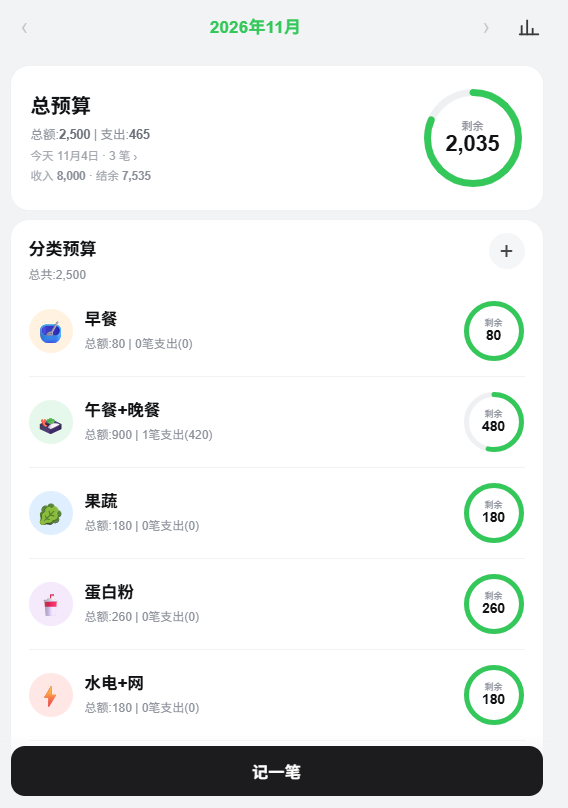
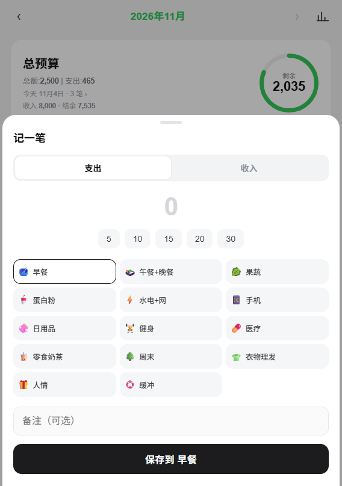
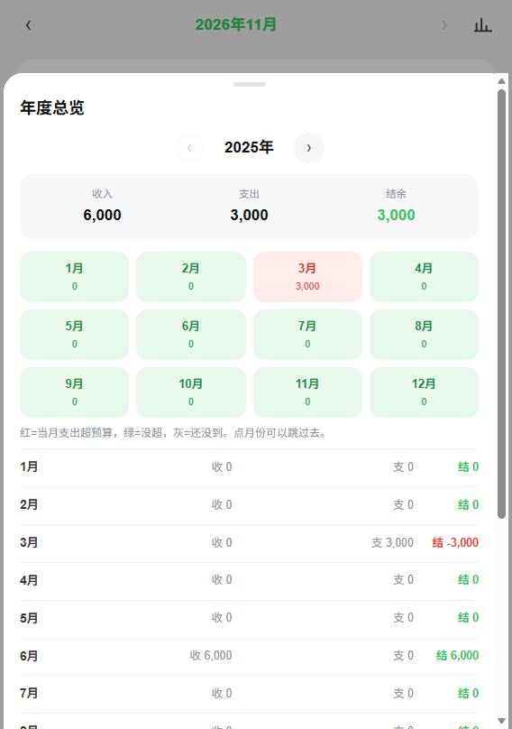

# 预算管理（网页版 + 安卓 APK）

一个手机优先的小记账工具：给每个分类设月预算，每记一笔就从对应分类里扣，首页用圆环显示余额——没超是绿色，超了是红色。总预算在顶部，等于各分类预算之和。







## 功能

- 分类预算：名称、金额、图标自己定，数量不限
- 记一笔：切「支出 / 收入」，支出选分类自动扣，收入只进结余
- 余额圆环：绿色「剩余 x」，超支红色「超支 x」
- 总预算：自动汇总，顶部大圆环；小字显示今天日期、笔数、收入和结余
- 顶部标题栏：月份居中，超总预算变红、没超变绿，左右箭头翻月，右侧图表按钮进年度总览
- 年度总览：按年汇总收入 / 支出 / 结余；12 个格子对应 12 个月，红=超预算、绿=没超、灰=还没到；可切换年份，点月份直接跳过去
- 删除单笔和清空操作都会先弹确认，防误触
- 跨月自动跳转：到下个月首页自动从 0 开始，旧月份记录保留
- 分类详情：当月每笔记录、删除、改预算
- 网页版数据存浏览器 localStorage，设置里可导出 / 导入 JSON 备份
- 安卓 APK 数据存 App 自己的 SharedPreferences，不联网、不申请权限
- 固定浅色，跟不跟随系统深色：没有

## 在电脑上打开

双击 `启动.bat`，浏览器会自动打开 `http://127.0.0.1:8765`。

或者在命令行里执行：

```bash
node serve.mjs
```

## 在手机上用

**方式一：同一 Wi-Fi 下临时用**

1. 电脑和手机连同一个 Wi-Fi
2. 电脑上运行 `node serve.mjs`，记下输出的「手机 http://192.168.x.x:8765」
3. 手机浏览器打开这个地址
4. Safari 点分享 → 添加到主屏幕，就有图标了

电脑关机后打不开；Windows 防火墙弹窗要允许 Node.js 访问专用网络。

**方式二：托管到静态网站（推荐，随时能用）**

`index.html` 是单文件、无依赖，传到任何静态托管都行：

- Netlify Drop：打开 app.netlify.com/drop，把整个 `budget` 文件夹拖进去，几秒后得到一个 https 链接
- GitHub Pages：新建仓库，上传 `index.html`，Settings → Pages 选 main 分支
- Vercel / Cloudflare Pages 同理

拿到 https 链接后，手机打开 → 添加到主屏幕。数据存在这台手机的浏览器里，换手机或清缓存前先在设置里导出备份。

## 安卓安装包

`android/预算管理.apk`（约 50 KB，v1.2，Android 5.0 及以上，targetSdk 34）

安装步骤：

1. 把 APK 传到手机：微信「文件传输助手」、USB、网盘都行
2. 在手机上点开这个文件
3. 系统提示「禁止安装未知应用」时，给文件管理器 / 浏览器开一次权限
4. 出现「未经 Play Protect 检查」时选「仍要安装」

装完桌面会出现「预算管理」图标，点开即用，不需要联网。

说明：

- 数据存在 App 自己的 SharedPreferences，卸载或清除应用数据会一起清掉
- 没有 INTERNET 权限，不申请任何权限
- 用的是自签名证书；以后升级 APK 必须用同一把钥匙（`android/signing/`），否则只能先卸载再装
- 这个 APK 是个人自用包，不上架应用商店

## 数据说明

- 网页版：浏览器 localStorage，键名 `budget_app_v1`
- 安卓版：App 内 SharedPreferences（`budget_store`），不经过浏览器
- 不联网、不上传、没有账号
- 同一台设备同一个浏览器 / App 才看得到自己的数据
- 清空浏览器数据或清除 App 数据会一起清掉

## 重新打包 APK

构建不依赖 Android Studio 和 Gradle，用 build-tools 直接拼：

1. 准备 JRE 17、`build-tools_r34-windows.zip`、`platform-35_r02.zip`，解压到 `%TEMP%\apkbuild`
2. 把反编译用的 ECJ 放到 `%TEMP%\apkbuild\ecj.jar`
3. 运行 `android\build.ps1`

签名用 `android\signing\` 里的 key.pk8 和 cert.pem；换签名会导致已装版本无法覆盖升级。

## 改成自己的预算

首次打开点「载入我的 2,500 方案」，会生成 14 个分类（早餐 80、午餐+晚餐 900、果蔬 180、蛋白粉 260、水电+网 180、手机 38、日用品 80、健身 163、医疗 50、零食奶茶 175、周末 120、衣物理发 80、人情 100、缓冲 94）。不想要就点「+」自己建，或在分类详情里删。
